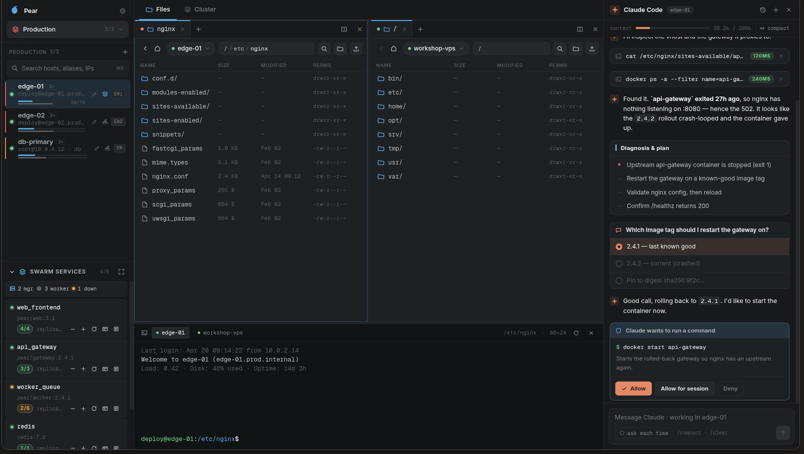

<p align="center">
  
</p>

<h1 align="center">Pear</h1>

<p align="center"><b>Every host, one workspace.</b><br/>
Files, terminal, live metrics and container orchestration for every server you run —
down to the shell inside the container.</p>

<p align="center">
  <a href="https://github.com/dmytro-kryvyi/pear-ssh/releases"></a>
  <a href="LICENSE"></a>
</p>



Pear is a free, open-source SSH workspace. No account, no backend, no telemetry —
hosts, keys and settings exist only on your machine, and secrets live in your OS
keychain.

## Features

- **Workspaces, not a flat list** — group hosts into colour-coded workspaces; a host can
  live in several. Your own PC is a host too (native PTY, no SSH involved).
- **Split-pane file manager** — tabbed panes, two hosts side by side, drag-and-drop
  cross-host transfers streamed through you (nothing buffered in memory), optional
  SHA-256 verification.
- **Editor & terminal on the host** — syntax-highlighted editing of remote configs; a
  real PTY per host that follows the directory you're browsing.
- **Live resource monitor** — per-core CPU, memory, load, network and mounts on one
  polling loop; micro-meters under each host row.
- **Orchestration that adapts** — Docker, Docker Swarm and Proxmox VE detected on
  connect; containers, replicas, VMs and LXC guests with live stats, task inspector and
  log streaming.
- **Sub-hosts** — "Jump in" to any container or guest and get a full workspace inside
  it, reusing the parent's SSH connection. Recursive: Docker inside LXC inside Proxmox
  is just a deeper breadcrumb.
- **Bastion chains** — set a host's `via` and Pear multiplexes shell, exec and SFTP
  through a real `forwardOut` channel; auth stays end-to-end.
- **Claude Code integration** — the AI runs as *your* local CLI on *your* subscription;
  it reaches hosts only through Pear's audited tools on a loopback-only MCP server.

## Install

Grab the latest build from **[Releases](https://github.com/dmytro-kryvyi/pear-ssh/releases)**:

| Platform | Status | Artifact |
|---|---|---|
| Linux | ✅ | AppImage · .deb |
| Windows 10/11 | ✅ | .exe (x64) |
| macOS | 🔨 build from source | needs someone with a Mac |
| Android | 🚧 in development | see [docs/ANDROID.md](docs/ANDROID.md) |

## Build from source

Requirements: Node 22+, npm 10+.

```sh
git clone https://github.com/dmytro-kryvyi/pear-ssh.git
cd pear-ssh
npm ci
npm start          # build everything and launch the desktop app
```

Other useful commands:

```sh
npm run dev            # watch-mode development
npm run dist:linux     # package AppImage/.deb (electron-builder)
npm run dist:win       # package Windows .exe
npm test -w core       # core test suite
npm run mobile:sync    # build web app + sync Capacitor (Android)
```

## Architecture

Pear is an npm-workspaces monorepo. The rule that shapes it: **core is UI-agnostic and
transport-owned; renderers never touch SSH or secrets directly.**

```
core/       @pear/core — SSH sessions, SFTP, exec, host inventory, monitoring,
            orchestration probes, transfers, Claude MCP server. Typed API
            (core/src/api.ts) consumed by every frontend. ssh2 + node-pty.
desktop/    Electron main process: window, IPC bridge over the core API,
            OS-keychain secrets via safeStorage (desktop/src/secrets.ts).
            The renderer only ever sees a "has a secret" flag — never material.
ui/         Angular renderer (zoneless, signals): workspaces, file panes,
            xterm.js terminals, Monaco editor, orchestration dashboards,
            Claude dock.
mobile/     Capacitor Android app reusing @pear/core's SessionManager behind
            a native SSH transport; the Kotlin engine lives in
            mobile/android/ssh-engine (sshj). Roadmap: docs/ANDROID.md.
site/       Static landing page (standalone, not a workspace) → Cloudflare Pages.
```

Releases are tag-driven: pushing `v1.2.3` builds and publishes desktop artifacts
(`.github/workflows/release.yml`) and the Android APK (`.github/workflows/android.yml`);
the tag is the single source of version truth.

## Contributing

See [CONTRIBUTING.md](CONTRIBUTING.md) for dev setup, test commands and PR guidelines.
Security reports: [SECURITY.md](SECURITY.md).

## License

[MIT](LICENSE) © Dmytro Kryvyi
